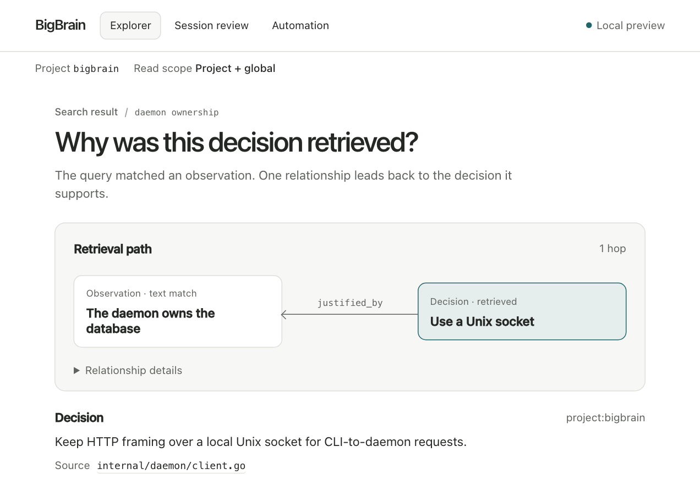

Let a reader follow a result back to the evidence that surfaced it. Keep search and the List / Graph control available, with List selected by default. When a result is selected, place a short reason beside its actual path and show the selected node's source directly below. Establish a compact shared header with navigation, bound project, Include global and connection state. Reuse the [graph projection](../../cmd/bigbrain/graph.go) and [paginated history](../../internal/protocol/lifecycle.go).

[Explorer interactions, scope and accessibility](references/ui-specification.md#2-explorer)

## Acceptance criteria

- Search A, A plus global and global only against an A/global/B fixture. Switching scope clears stale selection and ignores late responses. Preserve input on empty, offline and fallback states. Global-only sends `include_global: false` and disables the toggle.
- Show the first nonempty line as the display label, full text/source in the inspector, and the actual retrieval explanation. Use **Filter loaded results**, selected-item **View history**, **Copy reference**, **Copy text** and attributed **Copy context**. The browser has no live context-injection action.
- Deduplicate edges from `reason.steps` and `reason.path` by relationship ID. Show stored direction and annotate reverse traversal separately. Hydrate missing text through bounded scoped queries or label it unavailable. Cap expansion at 50 nodes/100 edges and label the displayed subset. Browsing leaves activation counts unchanged.
- Search, inspect and copy using only the keyboard; expose relationships in a table. On narrow screens keep search/scope available and open the inspector separately. Support visible focus, text labels and reduced motion.
- In a one-hop fixture, identify the text match, follow the labeled relationship and select either node to inspect its own source. The reason and diagram reflect the returned path. For a direct match, show the matched terms and source without adding an edge.
