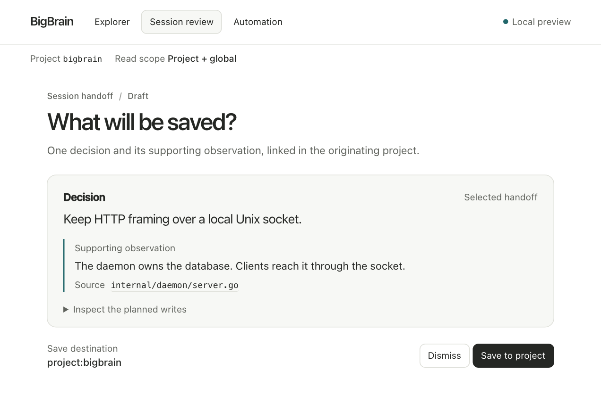

Keep the draft list and multi-selection available. In the selected draft, pair each proposed decision with its attributed evidence and show the immutable destination beside **Save to project**. Let the reader expand the selected handoff to inspect the planned record and link operations. Reuse the Explorer header and the handoff API. Offer **Dismiss** as the secondary action.

[Session review interactions and states](references/ui-specification.md#3-session-review)

## Acceptance criteria

- A keyboard user can select a draft, edit its text/type/source reference, inspect attribution and save or dismiss it. At narrow widths each pane is reachable in sequence. Show missing sources, invalid edits, empty queues and stale bindings explicitly.
- Surface draft, saving, saved, dismissed, partial and unknown outcomes per item. Guard pending submissions. After an interrupted multi-item save, retry with the original frozen payload and keys even if the viewer filter changes.
- Use existing memory types. “Procedure” displays `procedural`; open questions stay in the handoff. Editing a source changes its reference only. Saving selected items uses the reviewed-write route and never publishes globally as a side effect.
- Before saving, a reader can identify the selected content, its source and the destination in the same reading sequence. Expanding the write details reveals only the operations in the selected handoff. Partial and uncertain outcomes remain visible when the details are collapsed.

<!-- kadai:log:start -->

## Log

### 2026-11-27T02:14:01-03:00

Tested selection and reviewed saving through Chromium at 320px after selecting global-only Explorer scope. Confirmed the canonical destination stayed project A. Simple-code review kept revision checks in Go and surfaced per-item outcomes, including retryable partial/uncertain states.

<!-- kadai:log:end -->
