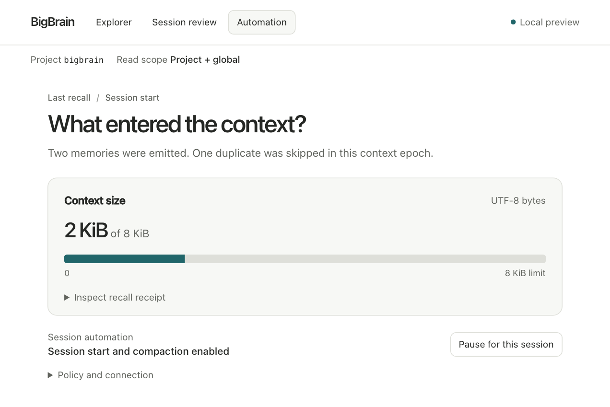

Lead with the last recall. Show the emitted byte count against the applicable limit in a labeled meter, then show how many memories were included or skipped and why. Keep policy rows, connection diagnostics and **Pause for this session** near the receipt. Reuse the Explorer header and the existing binding, policy, capability and receipt helpers.

[Automation defaults, actions and accessibility](references/ui-specification.md#4-automation)

## Acceptance criteria

- Show startup and post-compaction recall as active only when supported and authorized. Per-prompt and subagent recall default off. Project reads include global by default. Show the five-memory and 8 KiB limits as enforced bounds. Automatic capture produces reviewable drafts.
- Distinguish configured policy, host trust, unsupported events, daemon disconnection and version mismatch. Change only the plugin's policy through allowlisted routes. An unavailable event is hidden or disabled with a reason.
- **Last recall** shows metadata and skip reasons. **Preview next context** recomputes a dry run from current active records without mutating deduplication state. Pausing suppresses future automatic recall/capture for this session while preserving drafts and keeping the viewer usable.
- Operate controls and inspect diagnostics by keyboard and on a narrow screen. Pair color with text for connection and trust states.
- With a sample receipt of 2,048 bytes under an 8,192-byte limit, the meter reads 2 KiB of 8 KiB and fills one quarter of the track. Keep counts, units and skip reasons readable without color. Before the first recall, show the empty state.

<!-- kadai:log:start -->

## Log

### 2026-11-27T02:15:32-03:00

Exercised the Automation screen against real Go receipt/policy storage. Preview returned active memory and left the receipt byte-identical. Session pause rejected automatic staging while preserving reviewed data. Simple-code review kept settings separate from observed host events and used one partial policy update per control.

<!-- kadai:log:end -->
