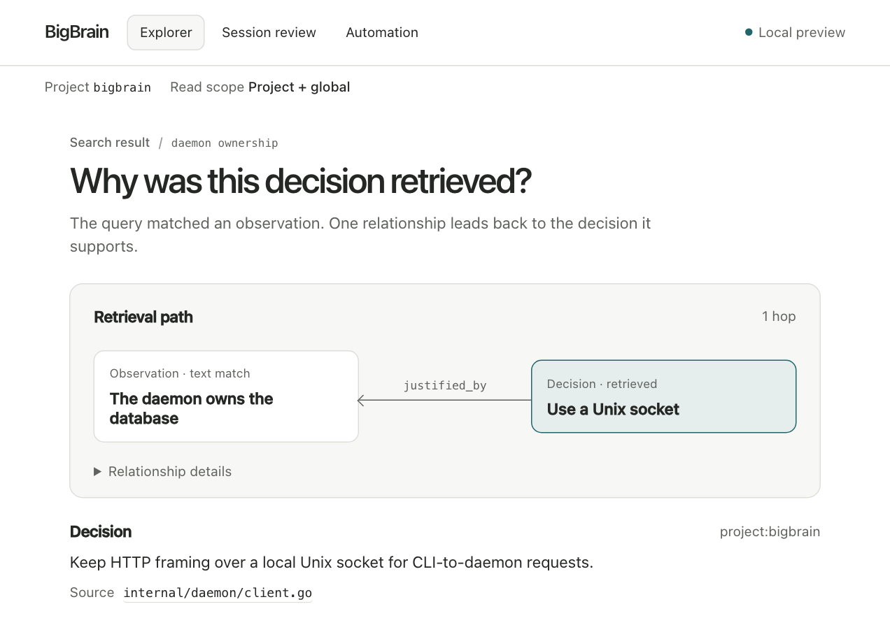
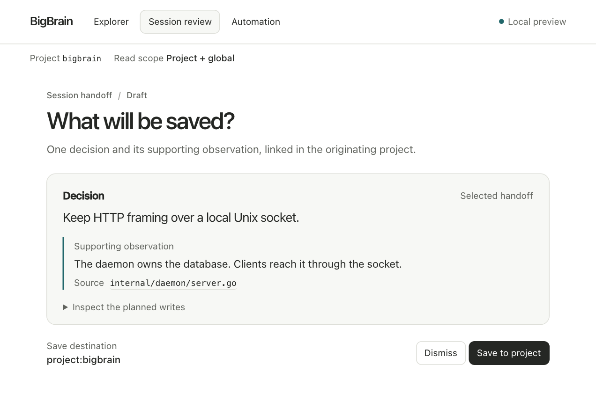
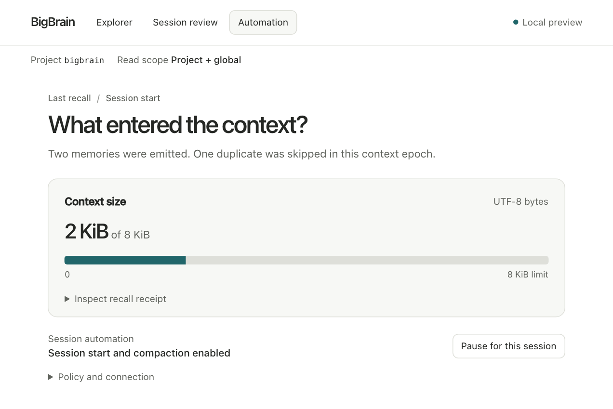

# UI specification

**Status:** proposed behavior. Mockup text, counts, and controls are illustrative; this specification and domain contracts are authoritative. Images do not establish native Codex sidebar or renderer support.

## 1. Surface and shared layout

Build one small memory workbench with three destinations: **Explorer**, **Session review**, and **Automation**. The baseline is a browser-local viewer. Reuse the same UI in an embedded host only after the platform capability check succeeds. Do not maintain two separate products or reproduce Codex application chrome.

Use the visual language of an interactive explanation in ChatGPT or Codex. Lead the selected view with the question a developer needs answered, a one-sentence answer grounded in the current result, and one visual that explains it. Give that visual enough room to read the labels. Place the relevant source or action beside it. Reveal secondary fields on selection or expansion. Keep search, scope, review and recovery actions reachable by keyboard.

Use a quiet neutral surface, a compact shared header, readable system typography and subtle dividers. Reserve one accent for the selected node, evidence marker or measured quantity. Pair it with a text label and adapt contrast to the viewer's light or dark appearance. Use the same reading order in the browser and on a verified embedded host.

The images below show selected states with sample data. The original [Explorer](../images/01-memory-explorer.png), [Session review](../images/02-session-review.png) and [Automation](../images/03-automation.png) concepts record the broader set of controls. Use the newer images below for visual hierarchy and this specification for behavior.

The header contains the BigBrain name, resolved project, **Include global** toggle, and connection state. **Include global defaults on** for project reads, preserving current implicit CLI/MCP read behavior. The plugin nevertheless sends the resolved scope and inclusion flag explicitly. Project-only and global-only reads remain deliberate selections. Global-only reads send `scope: global` and `include_global: false`; disable the inclusion toggle because the current protocol rejects it set to true for that scope.

Global means shared across projects in the same local database; it does not mean Internet publication. Including global in a read never changes a save destination. Draft saves remain locked to their originating project. Project scope must not be described as a security boundary between agents using the same operating-system account.

Display a memory's first nonempty line as its compact label, truncating only the presentation. Do not invent a persisted `title` field. Use the label **Procedure** for the existing `procedural` type. An **Open questions** section belongs to a handoff, not a new memory type.

## 2. Explorer

For a selected result, explain why it matched. Label the matched seed and the retrieved memory, annotate the returned relationship, and let either node reveal its source in place. A direct text match needs only the matched terms and source. Preserve access to search and the current result list during inspection.

The workspace combines a search field, concise result rows, a **List / Graph** switch, and a detail inspector. A selected result shows its text, type, scope, source, and the retrieval explanation actually returned by BigBrain. A source is a reference to inspect, not an instruction to execute.

List mode is the accessible default. Graph mode presents the selected result's returned retrieval path and already loaded relationships. The read-only MVP uses the existing query/history contract and extends the current HTML visualization's selected-path approach. It does not assume that search results expose every memory, every neighbor, a stable collection total, or graph-wide browsing. See the reviewed [graph renderer](https://github.com/ewertonls/bigbrain/blob/c6758ba4fe3649b30488ca17a196d39e0b9e6be0/cmd/bigbrain/graph.go) and [query contract](https://github.com/ewertonls/bigbrain/blob/c6758ba4fe3649b30488ca17a196d39e0b9e6be0/internal/protocol/protocol.go).

### Selection and graph behavior

Selecting a result highlights its memory and returned path. Selecting a related node opens available details while retaining the search. Missing node metadata falls back to an ID and an explicit loading or unavailable state, never fabricated memory text. Preserve stored edge direction; annotate reverse traversal separately. Do not reverse an edge's meaning to match the direction in which retrieval found it.

Cap the view at 50 nodes and 100 edges. Show displayed counts and truncation; these are not database totals. Zoom, reset, selection, and node dragging are local view operations. The MVP does not edit relationships or weights.

A type or text filter must say **Filter loaded results**. Bounded expansion from known IDs may use paginated history within the view caps. Collection-wide filters and all-memory browsing require a later browse operation. The mockup's **Active** selector must not imply a supported collection-wide history filter; use selected-memory **View history** initially.

### Context actions

The baseline inspector offers **Copy reference**, **Copy text**, and **Copy context**. The copied context includes attribution and a reminder to treat memory content as data. The mockup's **Use in context** action is capability-gated: it may become a documented host action, or an explicit selection for the next supported hook receipt. Neither option may imply that a browser button can silently modify a live model context. Label a queued action **Include in next recall** and show its pending state.

Changing scope invalidates stale results and selection. Late responses from the previous scope are ignored. Preserve the query when a request fails; never widen scope silently to produce results.

## 3. Session review

This view shows proposed handoffs or capture drafts before saving. Selecting a candidate opens its editable preview. Group its text, type, evidence and attributed source in reading order, followed by the destination and save action. Offer an expandable list of the actual planned writes. Keep multi-selection and per-item outcomes available from the candidate list. Show **Draft**, **Partial**, **Saved**, **Dismissed**, and **Save status unknown** distinctly. The originating project remains visible and immutable.

The primary action is **Save to project**; **Dismiss** is secondary. Multi-selection saves are resumable, not atomic; report per-item outcomes. **Edit source** edits a reference, not the source file. Attribute user excerpts, agent handoffs, and hook payloads accurately. A transcript excerpt is not verified knowledge, and a lifecycle event may provide neither full transcript nor summary.

Two objects remain separate:

- **Capture draft:** bounded local plugin staging, excluded from normal memory retrieval until explicitly saved.
- **Existing `lesson_proposal`:** a domain consolidation record that already participates in BigBrain's searchable local proposal/publication workflow.

A draft list is not a new learning engine and should not silently create `lesson_proposal` records. Saving ordinary captured knowledge uses the appropriate existing domain operation. Reviewing or publishing an existing proposal is a separate later flow, preserving its current semantics. No automatic global publication belongs in default capture.

**Open questions** can appear inside the handoff preview. They should not be silently converted into facts, resolved decisions, or a new schema type. A suggested similar memory is advisory; similarity alone must not merge, invalidate, or delete anything.

Before a save, freeze the exact payload and idempotency key. Disable duplicate submission while the request is pending. If acknowledgement is lost, preserve the operation and offer retry with the same payload and key. A timeout does not prove failure. Editing an uncertain operation must not overwrite its frozen payload; resolve its status before a separate revised save.

Limit a session to 50 pending drafts and each serialized draft to 64 KiB. Show empty, source-missing, edited, invalid, stale-binding, partial-save, and uncertain-save states. Keep failed or uncertain operations recoverable. Reject additional drafts at capacity; never evict uncertain work. Show unavailable sources honestly.

## 4. Automation

Lead with the last recall receipt. Show the emitted bytes and the limit that applied to that recall on a single labeled meter, with emitted and skipped counts nearby. Show only available receipt values. If the historical limit is unavailable, show the byte count alone. Empty or unavailable receipts have their own states. Place policy and connection details below the receipt. Settings describe plugin policy; the host manages hook trust and permissions.

Display only events supported by the recorded capability receipt. Unsupported events are omitted or disabled with a short explanation. A configured policy and an authorized, functioning hook are separate states. When authorization is required, explain that it must occur through the host's supported mechanism; a BigBrain toggle cannot grant it.

Default policy:

| Setting | Default |
| --- | --- |
| Session recall | Enabled when the required event is supported and authorized |
| Post-compaction recall | Enabled when supported and authorized |
| Per-prompt recall | Off |
| Subagent recall/capture | Off |
| Recall result limit | At most 5 memories |
| Emitted context size | Absolute 8 KiB UTF-8 byte cap, including wrapper and references |
| Include global memory | On for reads |
| Capture | Create reviewable handoff drafts when supported |
| Automatic project/global saves | Off |

The byte cap is the enforceable limit; token estimates are optional and must be labeled estimates. Do not claim an exact token budget without a compatible tokenizer. Retain a concise attribution for every included memory and omit lower-priority entries before exceeding the absolute cap. The renderer must report truncation honestly.

**Last recall** shows only included memory IDs, a payload hash, counts, bytes emitted, and duplicate or budget skip reasons. Durable receipts never retain memory text. **Preview next context** performs a dry run against current active memories without changing deduplication state; it previews what could be emitted now, not the exact historical prompt. Deleted or invalidated text must not remain available through a stored receipt.

**Pause for this session** prevents future automatic recall/capture without deleting memory or drafts. Replace the mockup's **Pause this project** label with that session-scoped action. The viewer remains useful while paused. Connection controls expose project, daemon availability, and compatibility. Diagnostics must not hide incompatibility or claim unavailable hooks succeeded.

## 5. State and accessibility contract

| State | Required behavior |
| --- | --- |
| Empty project or no results | Explain the state and preserve scope; offer a new query or deliberate scope change |
| Retrieval fallback | Show the actual text/associative fallback reported by the backend |
| Loading or disconnected | Retain useful input; identify pending versus unavailable data |
| Version mismatch | Show actionable client/daemon incompatibility; do not display cached content as current |
| Truncated response | Label partial results and expose supported pagination |
| Invalidated/deleted item | Respect existing history semantics; avoid presenting stale content as active |
| Paused or unsupported automation | Show why automatic work will not run |
| Uncertain save | Preserve request identity and expose safe retry |

Keyboard users must be able to search, select, inspect sources, review drafts, and save without manipulating a graph canvas. Provide an equivalent relationship table with source, target, type, and direction. Use text labels alongside color, visible focus, sufficient contrast, and reduced motion. Stop graph layout movement after selection.

At narrow widths, show one content pane at a time, with the inspector as a separate panel. Keep scope and search available. Handle long paths, project names, and memory text without losing meaning. Readable full text belongs in the inspector; visual truncation must not change copied or saved content.

## 6. Implementation boundary

Use a small TypeScript frontend with Vite for development/build if it fits the repository. This is a build-time toolchain, not a requirement to run Node on the user's machine. Embed the produced static assets in the Go executable. A full application framework is optional; choose it only when the actual interaction complexity justifies it.

Put host-specific behavior behind a narrow transport adapter: domain query/history, draft operations, policy/receipt access, and capabilities. The browser adapter talks to the local Go bridge; an embedded adapter uses only verified host APIs. Both consume the same scoped data model and UI components. Backend visibility and domain validation remain authoritative.

The helper's proposed shared durable state location is `$XDG_STATE_HOME/bigbrain/codex`, falling back to `~/.local/state/bigbrain/codex`, with private directories/files (`0700`/`0600`). This is separate from canonical memory. Use plugin data storage only for the launcher pointers `executable.path` and `state.path`; an optional companion must receive the same explicit state directory.

